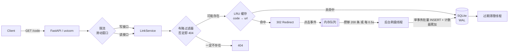

<div align="center">

# shrinkr

自托管短链服务，单文件 SQLite，不需要 Redis。

[](https://github.com/TheFool-TAROT/shrinkr/actions/workflows/ci.yml)
[](LICENSE)
[](pyproject.toml)

[English](README_EN.md) | 简体中文

</div>

---

短链服务的读流量里，很大一部分短码根本不存在。扫描器拿字典爆破、用户手输错一位、链接早就过期了——朴素实现对这些请求一律查库，SQLite 的连接和 IO 就这么被吃掉了。

shrinkr 在这条路径上挡了三层：布隆过滤器先否掉不存在的，LRU 缓存接住热链接，剩下真正需要回表的才落到 SQLite。

写侧也有一处。每次点击都同步 `UPDATE` 是典型的写放大，热点链接会把写锁占满，所以点击事件先进内存队列，后台线程攒批合并落盘。

---

## 实测

2 vCPU 云主机，Python 3.14，uvicorn 单 worker，压测工具 `ab` 和被测服务同机跑——互相争抢 CPU，所以这些数字偏保守。

读路径（302 重定向，`ab -k -n 20000`）：

| 并发 | QPS | P50 | P95 | P99 | 失败 |
|---|---|---|---|---|---|
| 50 | 1061 | 46 ms | 60 ms | 70 ms | 0 |
| 100 | 1122 | 89 ms | 111 ms | 131 ms | 0 |
| 200 | 970 | 210 ms | 247 ms | 259 ms | 0 |

并发上到 200 反而掉到 970，是单个 uvicorn worker 的排队效应，不是数据层的问题，没做进一步优化。

数据结构层（`python bench/micro.py`）：

| 操作 | 吞吐 | 单次 |
|---|---|---|
| `bloom.contains`（20 万条已加载） | 260,603 ops/s | 3.84 µs |
| `base62.encode + decode` | 786,413 ops/s | 1.27 µs |
| `lru.get`（2 万容量满） | 1,208,961 ops/s | 0.83 µs |
| `ratelimit.check`（滑动窗口） | 1,049,902 ops/s | 0.95 µs |

把点击写从请求路径上摘掉前后：

| | 前（BackgroundTasks + 同步写） | 后（内存队列 + 批量落盘） |
|---|---|---|
| QPS @ c=100 | 773 | 1122 |
| P50 | 129 ms | 89 ms |
| P99 | 172 ms | 131 ms |

跑完 6 万次重定向，`/metrics` 的计数和 `clicks` 表对得上，一行没少。

CI 里每次 push 也会跑一次压测（`bench/loadtest.py`，httpx 客户端，比 `ab` 重）：

| | GitHub Actions 2-core |
|---|---|
| 请求数 / 并发 | 3000 / 32 |
| QPS | 433 |
| P50 / P95 / P99 | 48.7 / 207.5 / 300.3 ms |

433 和 1122 的差距主要来自 runner 的 CPU 配额和 Python 客户端自身的开销。压测数字不写环境就没意义，所以上面每张表都标了。

---

## 跑起来

```bash
pip install -r requirements.txt
uvicorn app.main:app --reload --port 8000
```

或者：

```bash
docker compose up -d
```

打开 `http://127.0.0.1:8000` 有个很简单的 Web UI，`/docs` 是 OpenAPI。

```bash
# 创建
curl -X POST http://127.0.0.1:8000/api/links \
  -H 'Content-Type: application/json' \
  -d '{"url":"https://example.com/very/long/path?x=1","custom_code":"promo2025","ttl_seconds":86400}'

# 跳转
curl -sI http://127.0.0.1:8000/promo2025 | grep -i location

# 统计
curl -s http://127.0.0.1:8000/api/links/promo2025/stats

# 删除（要 SHRINKR_ADMIN_TOKEN）
curl -X DELETE http://127.0.0.1:8000/api/links/promo2025 \
  -H 'Authorization: Bearer change-me'
```

## 功能

短码用自增 ID 做 Base62 编码，不会冲突，也可以自己指定别名（3–32 位）。链接可以设 TTL，过期后惰性返回 410，后台线程负责回收。

点击统计记总数、独立访客、按天曲线和 Referer TopN。写接口按 IP 滑动窗口限流，超了返回 429 带 `Retry-After`；`TRUST_PROXY` 控制是否相信 `X-Forwarded-For`，默认不信，否则谁都能伪造 header 绕过限流。

创建链接时会校验 scheme，挡掉 `javascript:`、`data:`、`file:` 这类能被拿去 XSS 的，以及指向自己的短链。

有 `/metrics`（Prometheus 文本格式）、`/healthz`（带存储探活），管理接口走 Bearer token。

## API

| 方法 | 路径 | 说明 |
|---|---|---|
| `POST` | `/api/links` | 创建（受限流约束），body: `url` / `custom_code?` / `ttl_seconds?` |
| `GET` | `/{code}` | 302 跳转，同时异步记一次点击 |
| `GET` | `/api/links/{code}` | 元信息 |
| `GET` | `/api/links/{code}/stats?days=30` | 点击统计 |
| `DELETE` | `/api/links/{code}` | 删除（Bearer） |
| `GET` | `/api/overview?limit=20` | 总量、活跃数、点击 TopN（Bearer） |
| `GET` | `/healthz` | 健康检查 |
| `GET` | `/metrics` | Prometheus |

## 配置

全部走环境变量，容器里不用改代码。

| 变量 | 默认 | |
|---|---|---|
| `SHRINKR_DB` | `data/shrinkr.db` | SQLite 路径 |
| `SHRINKR_BASE_URL` | `http://127.0.0.1:8000` | 生成短链的前缀 |
| `SHRINKR_ADMIN_TOKEN` | 空 | 空则禁用管理接口 |
| `SHRINKR_DEFAULT_TTL` | `0` | 默认有效期，0 = 不过期 |
| `SHRINKR_MAX_TTL` | `31536000` | 有效期上限 |
| `SHRINKR_RATE_LIMIT` / `_WINDOW` | `60` / `60` | 写接口限流 |
| `SHRINKR_TRUST_PROXY` | `0` | 置 1 才信 `X-Forwarded-For` |
| `SHRINKR_CACHE_SIZE` | `20000` | LRU 容量 |
| `SHRINKR_BLOOM_CAPACITY` / `_ERROR_RATE` | `200000` / `0.001` | 布隆参数 |

## 架构



```
app/
├── config.py      # 环境变量 -> Config
├── db.py          # SQLite 连接 / 事务（WAL + busy_timeout）
├── base62.py      # 自增 ID <-> 短码
├── bloom.py       # 布隆过滤器（参数推导 + Kirsch-Mitzenmacher）
├── cache.py       # 线程安全 LRU + 命中率
├── ratelimit.py   # 滑动窗口
├── clicks.py      # 点击批量写入
├── meters.py      # 指标 + Prometheus 导出
├── service.py     # 业务逻辑，不依赖框架，可单独测
└── main.py        # HTTP 层
```

## 几个取舍

**不上 Redis。** 定位就是一台 1C1G 的 VPS 能自托管，多一个组件多一份运维和故障面。单机读场景用进程内 LRU 加布隆够用，接口留得很窄，真要换只改 `cache.py` 和 `bloom.py` 两个文件。什么时候必须换：多实例、队列要不丢、布隆要持久化。

**SQLite 而不是 MySQL。** WAL 下读并发、写串行，正好对上读远多于写。单文件，`docker run` 就起来。代价是复杂度得自己扛——本来该中间件干的活，现在都在代码里。

**布隆过滤器删不掉条目。** 删链接时清不了位，残留的位只会造成假阳性：多查一次 DB，返回 404。不会造成假阴性，不会返回错的 URL。填充率过 70% 时重建索引。

**短码可枚举。** 用自增 ID 编码，天生无冲突、长度可控，代价是别人能按顺序猜。隐私敏感的场景应该用自定义别名或加盐哈希换个更长的码——这是明知代价的选择，不是没考虑到。

**点击可能丢。** 队列在内存里，`kill -9` 最多丢 0.5 秒的批次。点击统计容忍最终一致，正常退出路径会把队列刷完再停。要求一条不丢就得换 Redis List 带消费位点，或者 Kafka。

**限流不用固定窗口。** 固定窗口在窗口交界会放行接近两倍流量。滑动窗口给每个 key 维护时间戳队列，判断前先弹过期的，内存 O(limit)/key，单 key 完全够。

## 测试

```bash
make test    # 46 passed
make cov
make lint
```

测的重点不是覆盖率数字，是几个容易写错的不变量：

- 布隆过滤器无假阴性（10 万次随机采样验证），假阳性率在预算内
- Base62 是双射，5000 个 ID 的编码集合无碰撞
- LRU 淘汰顺序、命中率统计
- 滑动窗口跨边界、per-key 隔离
- 批量写入器攒批触发、关机兜底刷盘不丢事件
- API 边界：非法 scheme、超长 URL、自指链接、保留字、重复别名、过期 410、鉴权 401、限流 429

## 还没做的

- 点击队列换 Redis / Kafka，做到进程崩溃零丢失
- 布隆过滤器持久化，现在是重启后从库里重建，20 万条要几秒
- 多实例部署 + 共享缓存，需要先解决上面两条
- 统计查询现在走业务库，数据量上来得拆到 ClickHouse
- 管理面板只有 API，没有界面

## License

MIT