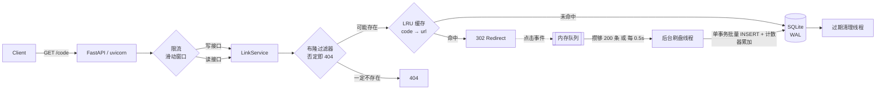

<div align="center">

# shrinkr

**自托管短链服务 · 无 Redis 也能扛读流量**

Bloom Filter 热路径过滤 + LRU 缓存 + 滑动窗口限流 + 点击批量落盘（单文件 SQLite，零外部依赖）

[](https://github.com/TheFool-TAROT/shrinkr/actions/workflows/ci.yml)
[](LICENSE)
[](pyproject.toml)
[](tests)

[English](README_EN.md) | 简体中文

</div>

---

## 这个项目解决什么问题

短链服务的真实流量结构是 **读远多于写**，而读流量里很大一部分是**根本不存在的短码**（扫描器爆破、手抖输错、过期链接）。

朴素实现每次都查一次数据库，于是 SQLite/MySQL 的连接和 IO 被无效查询吃掉。shrinkr 的思路是：

> **能在内存里挡掉的请求，绝不落到磁盘。**

三层过滤，逐层收敛：

| 层 | 结构 | 作用 | 实测 |
|---|---|---|---|
| 1 | 布隆过滤器 | 说「不存在」就一定不存在，直接 404，零 DB 访问 | 26 万次/秒，20 万条索引仅 351 KB |
| 2 | LRU 缓存 | 命中热链接直接 302，零 DB 访问 | 120 万次/秒 |
| 3 | SQLite (WAL) | 前两层没挡住才回查，兜底正确性 | 冷启动/兜底 |

写侧同理：每次点击都同步 `UPDATE` 是典型的写放大，热点链接会把写锁占满。shrinkr 把点击事件丢进内存队列，后台线程攒批合并落盘，**写入次数从 O(请求数) 降到 O(批次)**。

---

## 性能实测

环境：2 vCPU 云主机，Python 3.14，`uvicorn` **单 worker**，压测工具 `ab` 与目标同机（互相争抢 CPU，所以数字偏保守）。

### HTTP 层（302 重定向读路径，`ab -k -n 20000`）

| 并发 | QPS | P50 | P95 | P99 | 失败 |
|---|---|---|---|---|---|
| 50 | 1061 | 46 ms | 60 ms | 70 ms | 0 |
| **100** | **1122** | **89 ms** | **111 ms** | **131 ms** | **0** |
| 200 | 970 | 210 ms | 247 ms | 259 ms | 0 |

### 数据结构层（`python bench/micro.py`）

| 基准 | 吞吐 | 单次耗时 |
|---|---|---|
| `bloom.contains`（已加载 20 万条） | 260,603 ops/s | 3.84 µs |
| `base62.encode + decode` | 786,413 ops/s | 1.27 µs |
| `lru.get`（2 万条容量满） | 1,208,961 ops/s | 0.83 µs |
| `ratelimit.check`（滑动窗口） | 1,049,902 ops/s | 0.95 µs |

### 一次优化前后的对照（真实 commit）

把点击写从请求路径剥离前 → 后：

| 指标 | 前（`BackgroundTasks` + 同步写） | 后（内存队列 + 后台批量落盘） | 变化 |
|---|---|---|---|
| QPS @ c=100 | 773 | **1122** | **+45%** |
| P50 | 129 ms | **89 ms** | **−31%** |
| P99 | 172 ms | **131 ms** | **−24%** |

> 6 万次重定向后 `/metrics` 与 `clicks` 表计数完全一致（60000 = 60000），缓存命中率 1.0，布隆过滤器估计假阳性 0 —— 优化提速没有牺牲数据完整性。

### CI 回归基线（GitHub Actions 2-core runner）

每次 push 都会自动跑一次读路径压测（`bench/loadtest.py`），用的是纯 Python httpx 客户端，比 `ab` 重得多：

| 指标 | CI runner 实测 |
|---|---|
| 请求数 / 并发 | 3000 / 32 |
| QPS | 433 |
| P50 / P95 / P99 | 48.7 ms / 207.5 ms / 300.3 ms |
| 失败率 | 0% |

同一套命令在本机 2 vCPU 上跑出 1122 QPS。**差异来源是 runner 的 CPU 配额和 Python 压测客户端自身的开销**——所以「测出多少」必须和「怎么测、在哪测」一起说，这也是本项目所有性能数字都标注环境的原因。

---

## 功能

- 🔗 **短码生成**：自增 ID + Base62 双射编码，天生无冲突；支持自定义别名（3–32 位）
- ⏱️ **TTL 过期**：按链接设置有效期，惰性判断 + 后台清理线程回收
- 📊 **点击统计**：总点击数、独立访客、按天趋势、Referer TopN
- 🚦 **滑动窗口限流**：按 IP 限流，返回 429 + `Retry-After`（`TRUST_PROXY` 控制是否相信 `X-Forwarded-For`）
- 🛡️ **URL 校验**：挡掉 `javascript:` / `data:` / `file:` 等可被拿去做 XSS 的 scheme，以及自指短链
- 📈 **可观测性**：`/metrics`（Prometheus 文本格式）、`/healthz`、结构化指标计数
- 🔌 **管理接口**：`DELETE /api/links/{code}`、`/api/overview`，Bearer Token 鉴权
- 🐳 **一键部署**：`docker compose up -d`，数据落在 named volume
- ✅ **46 个测试**：数据结构不变量、并发行为、API 边界、限流与鉴权全覆盖

---

## 快速开始

```bash
# 方式一：本地跑
pip install -r requirements.txt
uvicorn app.main:app --reload --port 8000
# 打开 http://127.0.0.1:8000 有极简 Web UI，http://127.0.0.1:8000/docs 有 OpenAPI 文档

# 方式二：Docker
docker compose up -d
# 打开 http://localhost:8000
```

```bash
# 创建短链
curl -X POST http://127.0.0.1:8000/api/links \
  -H 'Content-Type: application/json' \
  -d '{"url":"https://example.com/very/long/path?x=1","custom_code":"promo2025","ttl_seconds":86400}'
# {"code":"promo2025","short_url":"http://127.0.0.1:8000/promo2025","url":"...","expires_at":...,"clicks":0}

# 跳转
curl -sI http://127.0.0.1:8000/promo2025 | grep -i location
# location: https://example.com/very/long/path?x=1

# 统计
curl -s http://127.0.0.1:8000/api/links/promo2025/stats

# 删除（需要 SHRINKR_ADMIN_TOKEN）
curl -X DELETE http://127.0.0.1:8000/api/links/promo2025 -H 'Authorization: Bearer change-me'
```

## API

| 方法 | 路径 | 说明 |
|---|---|---|
| `POST` | `/api/links` | 创建短链（限流），body: `url` / `custom_code?` / `ttl_seconds?` |
| `GET` | `/{code}` | 302 跳转，同时异步记录点击 |
| `GET` | `/api/links/{code}` | 短链元信息 |
| `GET` | `/api/links/{code}/stats?days=30` | 点击统计 |
| `DELETE` | `/api/links/{code}` | 删除（Bearer 鉴权） |
| `GET` | `/api/overview?limit=20` | 全局概览：总量、活跃数、点击 TopN（Bearer 鉴权） |
| `GET` | `/healthz` | 健康检查（含存储探活） |
| `GET` | `/metrics` | Prometheus 指标 |

## 配置

全部通过环境变量，容器里零改代码：

| 变量 | 默认 | 说明 |
|---|---|---|
| `SHRINKR_DB` | `data/shrinkr.db` | SQLite 路径 |
| `SHRINKR_BASE_URL` | `http://127.0.0.1:8000` | 生成短链时用的前缀 |
| `SHRINKR_ADMIN_TOKEN` | 空 | 空则禁用管理接口 |
| `SHRINKR_DEFAULT_TTL` | `0` | 默认有效期秒数，0 = 永不过期 |
| `SHRINKR_MAX_TTL` | `31536000` | 有效期上限 |
| `SHRINKR_RATE_LIMIT` / `SHRINKR_RATE_WINDOW` | `60` / `60` | 写接口限流阈值 |
| `SHRINKR_TRUST_PROXY` | `0` | 置 1 才信任 `X-Forwarded-For` |
| `SHRINKR_CACHE_SIZE` | `20000` | LRU 容量 |
| `SHRINKR_BLOOM_CAPACITY` / `_ERROR_RATE` | `200000` / `0.001` | 布隆过滤器参数 |

---

## 架构



```
app/
├── config.py      # 环境变量 -> Config
├── db.py          # SQLite 连接 / 事务封装（WAL + busy_timeout）
├── base62.py      # 自增 ID <-> 短码 双射编码
├── bloom.py       # 布隆过滤器（参数推导 + Kirsch-Mitzenmacher 双哈希）
├── cache.py       # 线程安全 LRU + 命中率统计
├── ratelimit.py   # 滑动窗口限流
├── clicks.py      # 点击事件批量写入器
├── meters.py      # 指标收集 + Prometheus 文本导出
├── service.py     # 业务逻辑（与框架解耦，可单独测试）
└── main.py        # HTTP 层（薄封装）
```

---

## 设计取舍

**为什么不用 Redis？**
项目定位是「一台 1C1G 的 VPS 就能自托管」。多一个组件就多一份运维成本和故障面。用进程内 LRU + 布隆过滤器已经能覆盖单机读场景，且换 Redis 只需替换 `cache.py` / `bloom.py` 两个文件——接口足够窄。真要多实例横向扩展时，这两处是可以替换的扩展点（见 Roadmap）。

**为什么用 SQLite 而不是 MySQL/Postgres？**
WAL 模式下读并发、写串行，正好匹配「读远多于写」；单文件部署 `docker run` 即跑。同时它把复杂度逼回代码里（缓存、布隆、批量写），而不是藏在运维里——这类取舍更适合讲清楚。

**布隆过滤器不支持删除，删掉的短码怎么办？**
残留位只会造成**假阳性**（多一次 DB 回查，结果为 404），不会造成假阴性（返回错误内容），正确性不受影响。填充率超过 70% 时触发重建，噪声自动清掉。

**为什么短码用自增 ID 编码，而不是随机串？**
随机串要「生成 → 查重 → 冲突重试」，每次重试都多一次 DB 往返；自增 ID 做 Base62 双射编码天生无冲突，且长度可控（10 万个链接只需 3 位）。代价是**短码可枚举**，所以对外有风险时应该配合自定义别名或加盐混淆——这个 trade-off 在 issue 里有讨论。

**批量写会不会丢数据？**
会丢最多一个批次（默认 0.5 秒内的事件），进程被 `kill -9` 时无法保证。点击统计属于可容忍最终一致的数据，这个取舍是自觉的。要求不丢就换 Redis 队列 / Kafka（Roadmap 第 1 项）。

**限流为什么不用固定窗口？**
固定窗口在窗口交界处会放行接近 2 倍流量。滑动窗口用「每个 key 一个时间戳队列」，判断时先弹出过期时间戳再看长度，精度换取 O(limit) 的内存 —— 对单 key 来说完全可接受。

---

## 测试

```bash
make test     # 46 passed
make cov      # 覆盖率报告
make lint     # ruff
```

覆盖的关键不变量：

- 布隆过滤器**无假阴性**（10 万次随机采样）且假阳性率在预算内
- Base62 **双射**（5000 个 ID 的编码集合无碰撞、长度可控）
- LRU 淘汰顺序、命中率统计正确
- 滑动窗口跨窗口边界与 per-key 隔离
- 点击批量写入器：攒批触发、关机兜底刷盘不丢事件
- API 边界：非法 scheme、超长 URL、自指链接、保留字、重复别名、过期 410、鉴权 401、限流 429

## Roadmap

- [ ] Redis / Kafka 版点击队列，做到进程崩溃零丢失
- [ ] 布隆过滤器持久化（RocksDB / 定期快照），实现秒级冷启动
- [ ] 多实例部署 + 共享缓存，附压测对比数据
- [ ] ClickHouse 承接统计查询，把分析从业务库彻底剥离
- [ ] 管理面板：TopN 排行、按天曲线、导出 CSV

## License

[MIT](LICENSE)