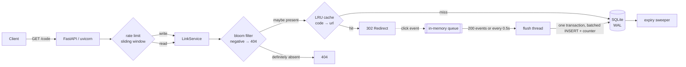

<div align="center">

# shrinkr

A self-hosted URL shortener. Single-file SQLite, no Redis.

[](https://github.com/TheFool-TAROT/shrinkr/actions/workflows/ci.yml)
[](LICENSE)
[](pyproject.toml)

English | [简体中文](README.md)

</div>

---

Most read traffic on a shortener is for codes that don't exist. Someone runs a wordlist against you, someone mistypes a code by one character, someone clicks a link that expired last month. The naive implementation queries the database every time, and SQLite's connections and IO get eaten by requests that were never going to resolve.

shrinkr puts three layers in front of that: a bloom filter rejects codes that definitely aren't there, an LRU cache catches the hot ones, and only what survives both actually reaches SQLite.

The write path has its own problem. A synchronous `UPDATE` on every click is write amplification — one popular link can hold the write lock all by itself. So clicks go into an in-memory queue and a background thread merges them into batched transactions.

---

## Measured

2 vCPU cloud box, Python 3.14, single `uvicorn` worker, with `ab` running on the same machine. The load generator and the server fight over the same cores, so these numbers are on the low side.

Read path (302 redirects, `ab -k -n 20000`):

| Concurrency | QPS | P50 | P95 | P99 | Failures |
|---|---|---|---|---|---|
| 50 | 1061 | 46 ms | 60 ms | 70 ms | 0 |
| 100 | 1122 | 89 ms | 111 ms | 131 ms | 0 |
| 200 | 970 | 210 ms | 247 ms | 259 ms | 0 |

Throughput drops at concurrency 200 because of queueing inside the single uvicorn worker. That's the HTTP layer, not the data layer, and I haven't tried to fix it.

Micro-benchmarks (`python bench/micro.py`):

| Operation | Throughput | Per call |
|---|---|---|
| `bloom.contains` (200k entries loaded) | 260,603 ops/s | 3.84 µs |
| `base62.encode + decode` | 786,413 ops/s | 1.27 µs |
| `lru.get` (20k capacity, full) | 1,208,961 ops/s | 0.83 µs |
| `ratelimit.check` (sliding window) | 1,049,902 ops/s | 0.95 µs |

Before and after moving click writes off the request path:

| | Before (`BackgroundTasks` + sync write) | After (queue + batched flush) |
|---|---|---|
| QPS @ c=100 | 773 | 1122 |
| P50 | 129 ms | 89 ms |
| P99 | 172 ms | 131 ms |

After 60,000 redirects the `/metrics` counter and the `clicks` table both read 60,000. Nothing was lost to get the speedup.

CI runs a load test on every push (`bench/loadtest.py`, httpx client — much heavier than `ab`):

| | GitHub Actions 2-core |
|---|---|
| Requests / concurrency | 3000 / 32 |
| QPS | 433 |
| P50 / P95 / P99 | 48.7 / 207.5 / 300.3 ms |

433 versus 1122 is mostly CPU quota and the Python client's own overhead. A benchmark without the box and the tool attached doesn't mean anything, which is why every table above says where it came from.

---

## Run it

```bash
pip install -r requirements.txt
uvicorn app.main:app --reload --port 8000
```

Or:

```bash
docker compose up -d
```

There's a minimal web UI at `http://127.0.0.1:8000` and OpenAPI docs at `/docs`.

```bash
# create
curl -X POST http://127.0.0.1:8000/api/links \
  -H 'Content-Type: application/json' \
  -d '{"url":"https://example.com/very/long/path?x=1","custom_code":"promo2025","ttl_seconds":86400}'

# redirect
curl -sI http://127.0.0.1:8000/promo2025 | grep -i location

# stats
curl -s http://127.0.0.1:8000/api/links/promo2025/stats

# delete (needs SHRINKR_ADMIN_TOKEN)
curl -X DELETE http://127.0.0.1:8000/api/links/promo2025 \
  -H 'Authorization: Bearer change-me'
```

## What's in it

Short codes are auto-increment IDs run through Base62, so collisions can't happen. You can also supply your own alias, 3–32 characters, with reserved words rejected. Links take an optional TTL; expired ones return 410 lazily and a background thread sweeps them up.

Click analytics track totals, unique visitors, a daily series and top referrers. The write endpoints are rate limited per IP with a sliding window, returning 429 with `Retry-After`. `TRUST_PROXY` controls whether `X-Forwarded-For` is believed — off by default, otherwise anyone can spoof the header and walk around the limiter.

Link creation validates the scheme and rejects `javascript:`, `data:`, `file:` and anything else that would make a decent XSS payload, plus links pointing back at the shortener itself.

There's `/metrics` in Prometheus text format, `/healthz` with a storage probe, and Bearer-token admin endpoints.

## API

| Method | Path | |
|---|---|---|
| `POST` | `/api/links` | Create (rate limited); body: `url` / `custom_code?` / `ttl_seconds?` |
| `GET` | `/{code}` | 302 redirect, records a click asynchronously |
| `GET` | `/api/links/{code}` | Metadata |
| `GET` | `/api/links/{code}/stats?days=30` | Click stats |
| `DELETE` | `/api/links/{code}` | Delete (Bearer) |
| `GET` | `/api/overview?limit=20` | Totals, active count, top links (Bearer) |
| `GET` | `/healthz` | Health check |
| `GET` | `/metrics` | Prometheus |

## Configuration

All environment variables. No code changes needed inside the container.

| Variable | Default | |
|---|---|---|
| `SHRINKR_DB` | `data/shrinkr.db` | SQLite path |
| `SHRINKR_BASE_URL` | `http://127.0.0.1:8000` | Prefix used when building short URLs |
| `SHRINKR_ADMIN_TOKEN` | empty | Empty disables the admin endpoints |
| `SHRINKR_DEFAULT_TTL` | `0` | Default TTL in seconds, 0 = never expires |
| `SHRINKR_MAX_TTL` | `31536000` | Upper bound on TTL |
| `SHRINKR_RATE_LIMIT` / `_WINDOW` | `60` / `60` | Write endpoint limiting |
| `SHRINKR_TRUST_PROXY` | `0` | Set to 1 to trust `X-Forwarded-For` |
| `SHRINKR_CACHE_SIZE` | `20000` | LRU capacity |
| `SHRINKR_BLOOM_CAPACITY` / `_ERROR_RATE` | `200000` / `0.001` | Bloom filter sizing |

## Architecture



```
app/
├── config.py      # env vars -> Config
├── db.py          # SQLite connection / transactions (WAL + busy_timeout)
├── base62.py      # auto-increment ID <-> short code
├── bloom.py       # bloom filter (sizing + Kirsch-Mitzenmacher)
├── cache.py       # thread-safe LRU with hit-rate stats
├── ratelimit.py   # sliding window
├── clicks.py      # batched click writer
├── meters.py      # counters + Prometheus export
├── service.py     # business logic, framework-free, testable on its own
└── main.py        # HTTP layer
```

## Trade-offs

**No Redis.** The target is a box you can run yourself; every extra service is another thing that can fail at 3am. In-process LRU plus a bloom filter covers the single-node read path, and the interface is deliberately narrow — swapping in Redis means editing `cache.py` and `bloom.py` and nothing else. When you'd have to: multiple instances, a queue that can't lose events, or a bloom filter that must survive restarts.

**SQLite rather than MySQL.** WAL gives you concurrent reads and serialized writes, which is exactly the shape of read-heavy traffic. One file, `docker run` and it's up. The cost is that complexity you'd normally push into middleware now lives in the codebase — cache, bloom, batched writes.

**The bloom filter can't delete.** When a link is deleted its bits stay set. That only produces false positives: an extra DB lookup that returns 404. It can't produce a false negative, so it can never serve the wrong URL. The index is rebuilt once the fill ratio passes 70%.

**Short codes are enumerable.** Auto-increment IDs encoded in Base62 can't collide and stay short, but anyone can walk them in order. If that matters, use custom aliases or a salted hash with a longer code. This is a known cost, not an oversight.

**Clicks can be lost.** The queue is in memory, so `kill -9` loses at most the last 0.5 seconds. For analytics that's an acceptable final-consistency trade, and the normal shutdown path drains the queue first. If you need exactly-once, switch to a Redis list with a consumer offset, or Kafka.

**Rate limiting isn't a fixed window.** Fixed windows let through close to twice the limit at the boundary. The sliding window keeps a timestamp queue per key and pops expired entries before checking length — O(limit) memory per key, which is fine at this scale.

## Tests

```bash
make test    # 46 passed
make cov
make lint
```

The tests target the invariants that are easy to get wrong, not a coverage number:

- the bloom filter has no false negatives (verified over 100k random probes) and its false-positive rate stays within budget
- Base62 is bijective — 5000 IDs, no collisions
- LRU eviction order and hit-rate accounting
- the sliding window across boundaries and per-key isolation
- the batched writer: flush on threshold, drain-on-shutdown without losing events
- API edges: bad schemes, oversized URLs, self-referencing links, reserved words, duplicate aliases, expired 410, auth 401, limiter 429

## Not done yet

- Move the click queue to Redis or Kafka so a crash loses nothing
- Persist the bloom filter — right now it's rebuilt from the database on boot, a few seconds for 200k entries
- Multi-instance deployment with a shared cache; needs the two items above first
- Stats queries currently hit the business database; at scale they belong in ClickHouse
- The admin side is API only, there's no UI

## License

MIT